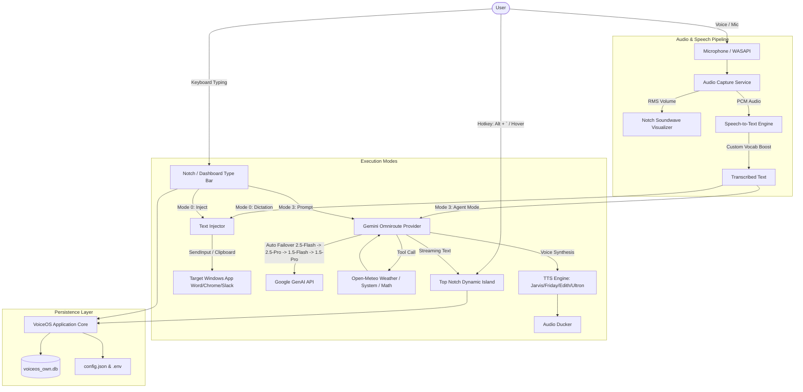

# VoiceOS-Own Architecture & Technical Specification

## Overview

**VoiceOS-Own** is an independent desktop application inspired by forensic reverse engineering of the VoiceOS application (v0.1.39). Built specifically for Windows 10/11 using Python 3.12 and PySide6 (Qt 6), it provides a luxury, stark **Black and White** user interface, an advanced **1:1 Top Notch Dynamic Island**, integrated **direct typing** prompt bars, **voice personas** (Jarvis, Friday, Edith, Ultron), and an intelligent **Gemini Omniroute** silent model failover engine.

---

## 1. Modular Subsystems

### 1.1 UI & Dynamic Island (`ui/`)
- **Main Window (`ui/main_window.py`):** High-contrast Black and White control center featuring Home with embedded direct typing prompt bar, Productivity Insights, History, Custom Dictionary, and Settings.
- **Top Notch Dynamic Island (`ui/notch_widget.py`):** Advanced 1:1 VoiceOS top notch with a 3-tier lifecycle:
  1. *Hidden (4px):* Invisible touchline at top-center of the screen.
  2. *Peeking (28px):* Sleek rounded pill smoothly sliding down on top-center mouse hover.
  3. *Expanded (160px):* Full interactive OLED dynamic island with integrated typing bar, mode selector, live 5-bar soundwave, mic toggle, send, and clipboard paste actions.
- **Side History Drawer (`ui/history_drawer.py`):** Slide-out panel for instant search, review, and one-click clipboard copying.
- **Onboarding Wizard (`ui/onboarding_dialog.py`):** First-run 4-step setup guiding user name, microphone test, modes, and Gemini API key verification.
- **System Tray (`ui/tray_icon.py`):** Background taskbar presence with Top Notch toggle and clean exit.

### 1.2 Core Windows Integration (`core/`)
- **Active Window Watcher (`core/window_watcher.py`):** Tracks active foreground window handle (`GetForegroundWindow`), window title, and process executable name.
- **Text Injector (`core/text_injector.py`):** Types text directly into the focused application via synthesized keystrokes, preserving and restoring clipboard contents.
- **Selection Reader (`core/selection_reader.py`):** Reads currently highlighted text from any application for contextual editing.
- **Global Hotkey Manager (`core/hotkeys.py`):** Registers Windows-wide hotkeys:
  - `Ctrl + Shift + D`: Toggle Dictation.
  - `Ctrl + Alt + A`: Toggle Agent Mode.
  - `Alt + \``: Toggle Top Notch Dynamic Island.
- **Database Manager (`core/database.py`):** SQLite persistence storing sessions, turns, tool calls, custom vocabulary words, and productivity metrics.
- **Config Manager (`core/config.py`):** Persistent configuration supporting themes, audio preferences, voice personas, and secure Gemini API keys.

### 1.3 AI Engine & Omniroute (`ai/`)
- **Abstract Base (`ai/base.py`):** Decouples UI and speech pipeline from vendor-specific LLMs.
- **Gemini Provider (`ai/gemini_provider.py`):** Uses the official Google GenAI SDK with Omniroute intelligent silent failover:
  - Tries `gemini-2.5-flash` first for lowest latency.
  - Silently routes to `gemini-2.5-pro` -> `gemini-1.5-flash` -> `gemini-1.5-pro` if rate limits, quota issues, or model availability errors occur.
  - 100% transparent: the user experience is never interrupted.
- **Agent Tools (`ai/tools.py`):**
  - `weather_forecast(location)`: Live Open-Meteo API query.
  - `calculate(expression)`: Safe math evaluator.
  - `get_current_time()`: Date and time query.
  - `system_status()`: Host CPU, RAM, OS, and battery levels.

### 1.4 Voice & Audio Pipeline (`audio/`)
- **Audio Capture (`audio/audio_capture.py`):** 48 kHz mono recording with real-time RMS audio energy calculation.
- **Speech-to-Text (`audio/stt_engine.py`):** Recognizes speech and injects user custom dictionary terms.
- **Text-to-Speech Engine (`audio/tts_engine.py`):** High performance speech synthesis supporting 4 distinct voice personas:
  - **Jarvis:** Calm, precise, articulate British male persona (175 wpm).
  - **Friday:** Warm, crisp, high-speed female assistant (195 wpm).
  - **Edith:** Gentle, smooth, tactical female intelligence (170 wpm).
  - **Ultron:** Deep, commanding, deliberate male presence (140 wpm).
- **Audio Ducking (`audio/audio_duck.py`):** Temporarily attenuates background audio during speech via `pycaw`.
