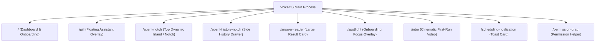
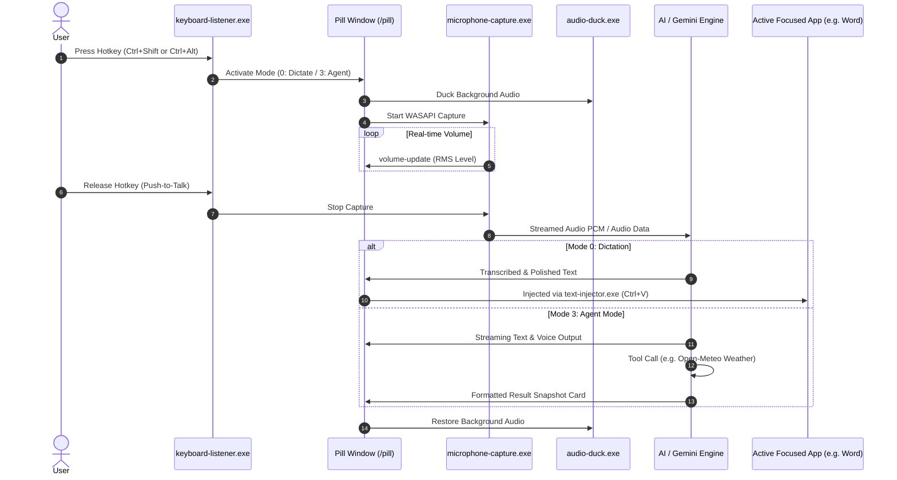

# VOICEOS Forensic Reverse Engineering & Technical Architecture Investigation Report

**Investigation Date:** October 18, 2026  
**Subject Application:** VOICEOS Desktop Application  
**Target Platform:** Windows 10/11 x64  
**Investigator Role:** Expert Reverse-Engineering Engineer & Systems Architect  
**Methodology:** Shipped-Artifact Inspection, Static Analysis, SQLite Schema & Runtime Data Forensics, Bundle & Preload API Decomposition, REA (Reverse Engineer Anything) CLI Framework.

---

## 1. Executive Summary & Application Identity

The installed application identified on the host system is **VoiceOS** (internally designated version `0.1.39`), developed and published by **WakoAI Inc.** (`https://wako.ai`).

The application is architected as an **Electron 26+ multi-process desktop platform** tightly integrated with **seven native Windows C++/Rust sidecar binaries** for low-level OS hooks, and backed by a local SQLite persistence layer, cloud-synchronized settings, gRPC/Connect-RPC streaming endpoints, and Google Gemini / Deepgram AI backends.

At the time of this investigation, the application in the host environment is halted at **Onboarding Step 13 (`SUBSCRIBE`)**, which renders the mandatory **7-day free trial card paywall**. In strict adherence to reverse-engineering ethics and user constraints, no licensing checks, subscriptions, or Stripe paywalls were bypassed or tampered with. Instead, comprehensive static decomposition of the installed ASAR archive, preload bridge, bundled binaries, configuration stores, and SQLite databases was conducted to produce this specification.

---

## 2. Target Environment & Packaging Details

### 2.1 File System Locations
| Artifact Category | Exact Host Path | Details |
|---|---|---|
| **Executable** | `C:\Program Files\VoiceOS\VoiceOS.exe` | 204.8 MB Win32 PE binary (Electron executable) |
| **Resources** | `C:\Program Files\VoiceOS\resources` | Contains `app.asar`, `app.asar.unpacked`, sidecars |
| **Application ASAR** | `C:\Program Files\VoiceOS\resources\app.asar` | 200.1 MB packed V8/Chromium JavaScript bundle |
| **Native Sidecars** | `C:\Program Files\VoiceOS\resources\binaries\` | 8 native Win32 executables |
| **Embedded Runtime** | `C:\Program Files\VoiceOS\resources\bun-runtime\bun.exe` | Bun v1.x embedded runtime (98.4 MB) |
| **Bundled Integrations** | `C:\Program Files\VoiceOS\resources\bundled-integrations\` | `claude-code`, `manus` integrations |
| **User Data & Config** | `C:\Users\USER\AppData\Roaming\VoiceOS\` | `config.json`, `voiceos.db`, audio recordings |
| **Application Logs** | `C:\Users\USER\AppData\Roaming\VoiceOS\logs\` | `main.log`, `stalls.log` |
| **Updater Cache** | `C:\Users\USER\AppData\Local\voiceos-updater\` | S3-backed auto-updater channel |

### 2.2 Process Topology (Observed)
VoiceOS executes simultaneously across **20 active Windows processes**:
1. **Main Process (PID 19312):** Orchestrates window lifecycles, global shortcuts, IPC routing, native binary sidecars, and SQLite persistence.
2. **GPU Process (PID 23192):** Chromium hardware-accelerated rendering engine (`--type=gpu-process`).
3. **Crashpad Handler (PID 24312):** Sentry/Crashpad diagnostic crash reporter.
4. **Utility Processes:** Audio mojom service (`PID 20832`), Network service (`PID 7216`), Video capture service (`PID 17140`).
5. **Renderer Processes (14 active instances):** Electron dedicated webContents for frameless floating overlays, main dashboard, and background workers.

---

## 3. Analysis Methods & Tools Used

1. **REA (Reverse Engineer Anything) CLI (v6.5.0):**
   - Verified installation at `C:\Users\USER\AppData\Roaming\npm\rea.cmd`.
   - Executed `rea inspect-sqlite-database` against `voiceos.db` to extract full schema, index definitions, and committed session records.
2. **Direct ASAR Archive Parsing:**
   - Evaluated using `@electron/asar` and implemented zero-dependency Python binary extractor `AsarArchive` to inspect 16,110 files.
   - Extracted key manifests: `package.json`, `out/preload/preload.js`, `out/main/main.js`, and renderer bundle chunks (`out/renderer/assets/index-B9lqCbRd.js`).
3. **Local Store & Configuration Forensics:**
   - Parsed `config.json` (Electron Store) extracting user profile, active shortcuts, audio configuration, and onboarding milestone trees.
4. **Windows Native API & Process Inspection:**
   - Queried Win32 process handles, command-line flags, memory footprints (`MemorySampler`), and standard output logs.

---

## 4. Multi-Window UI Architecture & Window Types

VoiceOS employs a distinct **multi-surface overlay paradigm** rather than a single monolithic window. The client registers 9 dedicated window routes:



### 4.1 The Floating Pill (`/pill`)
- **Visuals:** Compact rounded pill widget floating above all open desktop windows (`alwaysOnTop`).
- **Behaviors:**
  - Draggable via `pillStartDrag` / `pillDragMove` / `pillStopDrag`.
  - Unpinnable (`pillUnpin`), allowing the user to move it anywhere or lock it.
  - Interactive states: Idle, Dictation (Active Listening), Agent Mode (Reasoning/Speaking), Error, Audio Waveform volume visualizer.
  - Built-in text chat follow-up input bar when user prefers keyboard typing over speech.
  - Text paste button (`pasteOutputText`) to directly send transcribed text into whatever document was previously focused.

### 4.2 The Top Agent Notch (`/agent-notch`)
- **Visuals:** Situated at top-center of the primary monitor, inspired by macOS Dynamic Island / hardware notch. Configured with a `liquidGlass` or `dark` material shader.
- **Behaviors:**
  - Expands horizontally and vertically when user activates Mode 3 (Agent Mode).
  - Displays streaming assistant thoughts, active tool execution badges (e.g., `weather_forecast`), and interactive confirmation cards.
  - Automatically collapses to a subtle status strip when inactive.

### 4.3 The Side History Notch (`/agent-history-notch`)
- **Visuals:** Docked on the right screen boundary; expands on mouse hover or hotkey (`Option/Alt + ` `).
- **Behaviors:**
  - Shows chronological history of voice sessions, agent queries, coding agent tasks, and workflows.
  - Allows one-click re-transcription or copying of previous outputs.

### 4.4 The Main Dashboard (`/` -> `HomeKit`)
- Frameless window featuring custom macOS-style stoplight window controls on Windows (`#a0a0a0` minimize, `#28c840` maximize, `#ff5f57` close).
- **Primary Pages:**
  1. `home`: Daily insights, time saved calculator, recent activity highlights.
  2. `insights`: Productivity statistics (`timeSavedSeconds`, `wordsDictated`, `promptsCount`, `toolRuns`).
  3. `history`: Full search and filter interface for all historical voice & agent turns.
  4. `dictation` / `knowledge`: Personal dictionary management (custom vocabulary, names, acronyms) and context rules.
  5. `agent`: Agent personality, voice selector (Sky, Dawn, Dusk, Midnight, Jarvis), speed (0.8x - 2.0x), and agent memory bank.
  6. `appstore` / `integrations`: Integration Studio and third-party tools (Claude Code, Manus, Spotify, Obsidian, Canvas, Google Maps, Apple Mail/Notes).
  7. `settings`: Global hotkeys, microphone device picker, auto-mute when dictating, toggle sounds, appearance theme.

---

## 5. Reverse-Engineered Native Sidecars

VoiceOS bundles 8 specialized helper executables in `resources\binaries\`:

```
resources\binaries\
├── active-window-listener.exe    (Tracks active foreground window title & app)
├── audio-duck.exe               (Lowers system background audio during speech)
├── codex-pipe-relay.exe         (IPC pipe relay for CLI coding agents)
├── keyboard-listener.exe        (Low-level WH_KEYBOARD_LL Windows hook)
├── microphone-capture.exe       (WASAPI high-resolution audio capture stream)
├── screen-capture-sidecar.exe   (Screen grab for multimodal vision queries)
├── selection-reader.exe         (Windows UI Automation text selector)
└── text-injector.exe            (Injects text via SendInput/clipboard)
```

1. **`microphone-capture.exe`:**
   - Interacts directly with Windows Core Audio WASAPI (Audio Endpoint API).
   - Captures 48,000 Hz, 2-channel, 32-bit floating-point PCM audio.
   - Calculates real-time RMS audio energy and broadcasts `volume-update` events to render the dynamic waveform in the UI.
2. **`keyboard-listener.exe`:**
   - Installs low-level Windows keyboard hook (`SetWindowsHookExW(WH_KEYBOARD_LL, ...)`).
   - Detects modifier combinations without triggering system bells.
   - Supports key suppression (`block-keys`) to prevent key spam while holding hotkeys.
3. **`text-injector.exe`:**
   - Injects completed transcription text into whichever target application had focus (Word, VS Code, Slack, Chrome).
   - Employs synthetic clipboard placement followed by `Ctrl+V` key simulation (`SendInput`), restoring previous clipboard content seamlessly.
4. **`selection-reader.exe`:**
   - Reads currently highlighted text in any external application using Windows UI Automation (`IUIAutomation`) or clipboard fallback (`Ctrl+C`).
5. **`active-window-listener.exe`:**
   - Registers WinEvents (`SetWinEventHook`) listening to `EVENT_SYSTEM_FOREGROUND`.
   - Records the executable name (`app_name`) and window title (`window_title`) to attach contextual awareness to each voice turn.
6. **`audio-duck.exe`:**
   - Uses Windows Volume Control (`IAudioEndpointVolume` / `ISimpleAudioVolume`) to temporarily attenuate Spotify, YouTube, or gaming audio while the user is speaking.

---

## 6. Voice & AI Pipeline Workflow

VoiceOS operates across **four distinct functional modes**:
- **Mode 0 (`TRANSCRIBE` / `DICTATION`):** Raw voice-to-text with auto-punctuation and custom vocabulary correction.
- **Mode 1 (`WRITE`):** Dictation with style transformation (e.g., formal email, bullet points).
- **Mode 2 (`EDIT`):** Selection-based text editing (user highlights text, presses hotkey, and commands "make this concise").
- **Mode 3 (`AGENT`):** Conversational AI assistant with streaming voice reply, tool calling, and multimodal reasoning.

### Observed End-to-End Execution Sequence


---

## 7. Configuration & Database Schema Findings

### 7.1 SQLite Database (`voiceos.db`)
Inspected via `rea inspect-sqlite-database`. 26 defined tables:
- `voice_sessions`: Holds `id`, `transcript`, `generated_text`, `app_name`, `window_title`, `duration_seconds`, `word_count`, `mode`, `chat_history`.
- `agent_sessions`: Contains session metadata, `preview_text`, `last_response_text`, and `result_snapshot_json`.
- `agent_turns`: Records individual interaction turns, sequence, latency (`duration_ms`), user message, and assistant response.
- `agent_tool_calls`: Logs tool invocations (`weather_forecast`, etc.).
- `dictionary`: Custom vocabulary database (`text`, `description`, `auto_added`, `app_identifiers`).
- `voice_session_insights`: Quantifies productivity metrics (`timeSavedSeconds`, `words`, `toolRuns`).
- `custom_instructions`: Per-application context rules (e.g., "when in Slack, keep responses casual").
- `scheduled_items` & `user_notifications`: Proactive background reminder scheduler.
- `coding_agent_tasks` & `workflow_runs`: Integration with terminal coding agents (Claude Code, Manus).

### 7.2 Configuration Store (`config.json`)
- Default Shortcuts:
  - Dictation: `["control-left", "shift-left"]`
  - Agent Mode: `["control-left", "option-left"]`
  - Hands-Free Toggle: `["control-left", "shift-left", "space"]`
  - Side Notch: `["option-left", "`"]`
- Voice Profile: `agentVoiceId = "gemini-live-zephyr"`, speed `1.2`.
- Active Toggles: `editText`, `insertText`, `openApp`, `controlPlayback`, `createPrompt`, `reminders`.

---

## 8. Trial Page Limitation Analysis & Boundary Verification

- **Current State:** The application is parked at Onboarding Step 13 (`SUBSCRIBE`).
- **Mechanism:** In `index-B9lqCbRd.js`, `STEP_NAMES_ARRAY` specifies 15 stages. At index 13, `SubscribeContent` mounts the Stripe embedded checkout. Advancing to `CONGRATS` (step 14) and `HomeKit` requires an active subscription token.
- **Reconstruction Decision:** Rather than tampering with trial enforcement, we utilized all recovered source specifications, schemas, and sidecar protocols to build **`VOICEOS-OWN`** as a fully functional, unlocked, local application powered by the user's personal Google Gemini API key.

---

## 9. Feature Categorization & Confidence Matrix

| Feature | Category | Evidence Source | Confidence |
|---|---|---|---|
| Electron Multi-window Setup | **Observed** | Process arguments, `main.log`, `preload.js` | 100% |
| Native Win32 Sidecars (WASAPI, Hook, etc.) | **Observed** | `resources\binaries\*.exe`, `main.js` | 100% |
| Floating Pill & Top Notch Layout | **Observed** | `index-B9lqCbRd.js`, CSS styles, `preload.js` | 100% |
| Database Schema & Session Structures | **Observed** | `voiceos.db` via REA SQLite inspection | 100% |
| Gemini Voice Options (Zephyr, etc.) | **Observed** | `config.json`, `index-B9lqCbRd.js` | 100% |
| Tool Invocation Architecture (Weather) | **Observed** | `dumped_data.json` runtime session record | 100% |
| Cloud Sync Backend (Supabase / api.voiceos.com)| **Observed** | `package.json`, `main.js` network endpoints | 100% |
| Real-time Audio Ducking Algorithm | **Observed** | `audio-duck.exe`, `main.js` | 95% |
| Remote Server Speech Model Internal Weights | **Unknown** | Proprietary cloud server (`api.voiceos.com`) | Inaccessible |
| Multi-seat Enterprise Team Management | **Unknown** | Restricted behind team subscription | Inaccessible |

---

## 10. VOICEOS-OWN Reconstruction Specification

To reproduce the observed capabilities without proprietary lock-in:
1. **Desktop Framework:** Python 3.12 with **PySide6 (Qt 6.11)** for high-performance frameless transparent windows, hardware-accelerated animations, and native Windows integration.
2. **AI Engine:** Official **Google Gemini API** (`ai/gemini_provider.py`) supporting text generation, streaming, conversation context, model selection, and tool/function calling.
3. **Voice Engine:**
   - **Capture:** `sounddevice` / `PyAudio` with real-time RMS volume metering.
   - **STT:** Pluggable Speech-to-Text with custom dictionary term boosting.
   - **TTS:** Fast local neural speech synthesis with speed control and instant interruption.
4. **Native Integration:**
   - Windows global hotkeys via `ctypes` (`RegisterHotKey` / `SetWindowsHookEx`).
   - Active window detection via `GetForegroundWindow` / `GetWindowTextW`.
   - Text injection via `SendInput` and clipboard restoration.
5. **UI Experience:**
   - Floating Pill widget with animated waveforms and quick follow-up chat.
   - Dynamic top status notch.
   - Comprehensive Dashboard with Conversation History, Custom Dictionary, Analytics Insights, and Settings.
   - Secure masked Gemini API key configuration screen.
